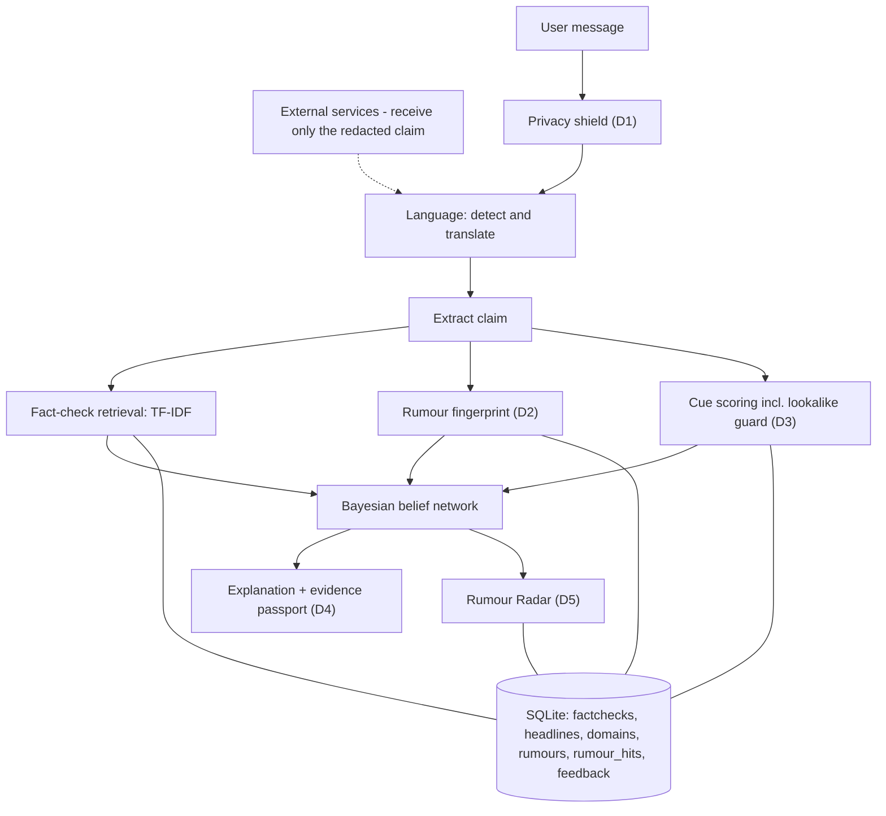
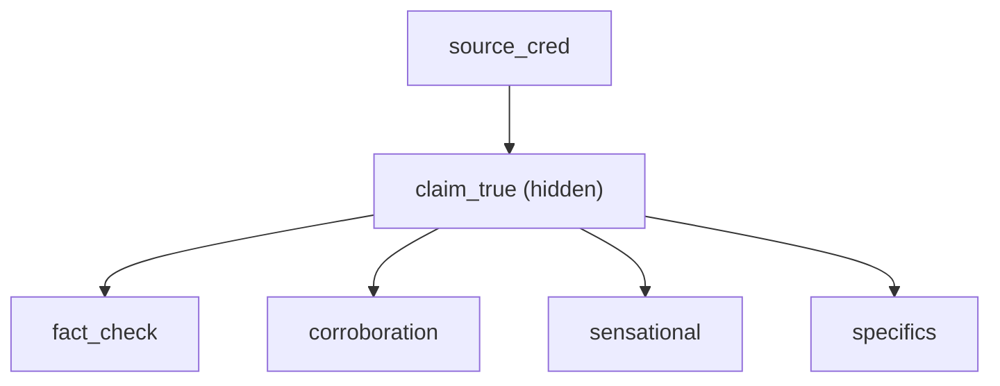
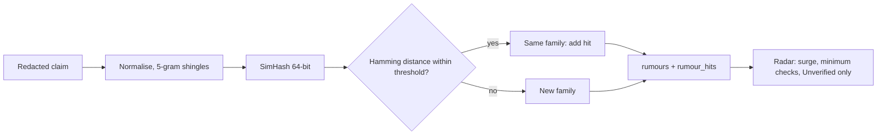

# VERITY

**A misinformation checker that shows its work, and admits when it does not know.**

VERITY takes a forwarded message (English, Tamil or Hindi), extracts the checkable claim, retrieves
matching published fact-checks, scores simple evidence cues and combines everything in a Bayesian
belief network. It returns one of three verdicts (`likely_false`, `unverified`, `likely_true`), the
probability behind it, ranked reasons, a what-if hint and a polite reply card. Honest abstention
("unverified") is a first-class output, and a verdict is never a bare "fake" or "real".

Five features go beyond asking a chatbot: **D1** privacy shield, **D2** rumour fingerprint,
**D3** lookalike-link guard, **D4** evidence passport and **D5** Rumour Radar.
Design documents: [PRD](docs/PRD.md) and [Technical Deep-Dive](docs/TRD.md).
The standing engineering rules for this repository are in [CONTRACT.md](CONTRACT.md).

## Architecture




The belief network (fixed structure, one hidden node):





Rumour fingerprint and Radar flow:




## Module-to-file map

Every syllabus topic in PRD section 4 and the file that implements it.

| Module | Topic | Implemented in |
|---|---|---|
| 1.3 | Applications of AI: misinformation triage | [src/verity/pipeline.py](src/verity/pipeline.py) |
| 1.5, 1.6 | Intelligent agent, environment (PEAS) | [docs/TRD.md](docs/TRD.md) section 1.1-1.2 |
| 2.4 | Best-first search: top-k fact-checks, best first | [src/verity/retrieval/index.py](src/verity/retrieval/index.py) |
| 5.1, 5.2 | Uncertainty, Bayes' rule, CPT design | [src/verity/bn/network.py](src/verity/bn/network.py), [data/cpt_priors.json](data/cpt_priors.json) |
| 5.3 | Building the six-node belief network | [src/verity/bn/network.py](src/verity/bn/network.py) |
| 5.4 | Approximate inference (likelihood weighting) | [src/verity/bn/sample.py](src/verity/bn/sample.py), [eval/convergence.py](eval/convergence.py) |
| 5.5 | Case study: the whole project | [src/verity/pipeline.py](src/verity/pipeline.py) |
| 7.1 | Language detection and translation | [src/verity/lang/](src/verity/lang/), [src/verity/clients/translate.py](src/verity/clients/translate.py) |
| 7.2 | Probabilistic language processing (n-gram tone) | [src/verity/cues/tone.py](src/verity/cues/tone.py), [src/verity/cues/train_tone.py](src/verity/cues/train_tone.py) |
| 7.3 | Information retrieval (TF-IDF, precision@k) | [src/verity/retrieval/](src/verity/retrieval/), [eval/retrieval_precision.py](eval/retrieval_precision.py) |
| 7.3 | D2 near-duplicate detection (SimHash), D5 families | [src/verity/rumour/fingerprint.py](src/verity/rumour/fingerprint.py), [family.py](src/verity/rumour/family.py), [radar.py](src/verity/rumour/radar.py) |
| 7.4 | Information extraction | [src/verity/extract/claim.py](src/verity/extract/claim.py) |
| 7.4 | D1 privacy shield, D3 link and domain extraction | [src/verity/privacy.py](src/verity/privacy.py), [src/verity/cues/links.py](src/verity/cues/links.py) |
| 5.2 | D3 sets the source node; D4 reasons and what-if reuse inference | [src/verity/cues/source.py](src/verity/cues/source.py), [src/verity/explain/](src/verity/explain/) |
| 8.1, 8.2 | Misinformation, critical evaluation, "what to check next" | [src/verity/explain/whatif.py](src/verity/explain/whatif.py), [src/verity/explain/reply.py](src/verity/explain/reply.py) |

## Setup

Requires Python 3.11 or newer (developed on 3.12).

```bash
make install        # venv, pinned dependencies, spaCy English model, requirements.lock
cp .env.example .env   # optional; the process environment is what the code reads
make setup          # database, domains, fact-checks, headlines, families, indexes, tone model, CPTs
```

`make setup` is safe to re-run and skips any step whose input is missing (it prints `[skip]` and why).
The content VERITY depends on is **supplied by a human** and is not invented anywhere in this
repository:

| What | Where | Status in this repo |
|---|---|---|
| Fact-check records | `FACTCHECK_API_KEY` + [data/seed_queries.txt](data/seed_queries.txt), or [data/seed_factchecks.jsonl](data/seed_factchecks.jsonl) (offline) | empty, to be supplied |
| Rating normalisation | [data/rating_map.json](data/rating_map.json) (review `data/unmapped_ratings.txt`) | empty, to be filled |
| Trusted / low-credibility domains | [data/domains.csv](data/domains.csv) | header only, to be approved |
| Trusted-outlet feeds | [data/feeds.txt](data/feeds.txt) | empty, to be supplied |
| Labelled messages (300) | [eval/labelled/README.md](eval/labelled/README.md) | to be written |
| Demo messages | [data/demo/](data/demo/) | `TODO` placeholders |
| CPT priors | [data/cpt_priors.json](data/cpt_priors.json) | expert guesses, **awaiting review** |

## Environment variables

Defined in [.env.example](.env.example) and validated in [src/verity/config.py](src/verity/config.py).

| Variable | Default | Meaning |
|---|---|---|
| `FACTCHECK_API_KEY` | empty | Google Fact Check Tools API key |
| `TRANSLATION_PROVIDER` | `none` | `none`, `hosted` (LibreTranslate-compatible API) or `indictrans2` (not wired up in this build) |
| `TRANSLATION_BASE`, `TRANSLATION_API_KEY` | empty | used when the provider is `hosted` |
| `DB_PATH`, `INDEX_DIR` | `./data/verity.db`, `./data/index` | storage |
| `VERDICT_THRESHOLD` | 0.75 | confidence needed for a non-abstaining verdict |
| `RETRIEVAL_TOP_K` | 5 | best-first candidates per index |
| `FACTCHECK_MATCH_THRESHOLD`, `HEADLINE_MATCH_THRESHOLD`, `TONE_THRESHOLD` | 0.40 / 0.40 / 0.50 | fact-check threshold swept on held-out published fact-checks (0.30 let 3 of 411 weak matches call a true claim false; 0.40 with stop words removed gave none and more coverage). The headline threshold was set the same way (at 0.30, 8% of debunked claims matched an unrelated headline; at 0.40, 1.5%). The tone threshold is an initial guess; tune on the dev split, then freeze |
| `MAX_MESSAGE_CHARS` | 5000 | input limit |
| `RANDOM_SEED`, `LIKELIHOOD_WEIGHTING_SAMPLES` | 42, 5000 | determinism and sampling |
| `SIMHASH_MAX_HAMMING` | 12 | D2 family threshold, swept on held-out fact-checks (14 added 30 matches, 3 of them wrong) |
| `LOOKALIKE_MAX_EDIT`, `LOOKALIKE_MIN_LEN` | 2, 6 | D3 edit distance and minimum trusted-domain length |
| `RADAR_MIN_COUNT`, `RADAR_WINDOW_HOURS` | 3, 24 | D5 minimum checks and window |
| `API_BASE`, `UI_PORT` | `http://localhost:8000`, 8501 | services |

## Running

```bash
make api      # FastAPI on :8000   (POST /check, POST /feedback, GET /health, GET /radar)
make ui       # Streamlit on :8501 (HTTP client only; the Radar is the second page)
make demo     # setup, then the seven-step demo (starts its own API if none is running)
```

Evaluation (all numbers are computed in the run; the test split needs `--final`):

```bash
python -m eval.retrieval_precision --split dev --k 3
python -m verity.cues.train_tone --csv eval/labelled/dev.csv
python -m verity.bn.learn --csv eval/labelled/dev.csv
python -m eval.threshold_sweep
python -m eval.convergence                 # likelihood weighting vs exact inference
python -m eval.run_eval --split dev        # writes eval/report.md and eval/report.json
python -m eval.final_run --candidates      # dev-tuned candidates; you choose, then --apply
python -m eval.final_run --final --confirm # the single test-split run
python -m scripts.simulate_radar           # SIMULATED Radar data (not measured usage)
```

Quality gates: `make lint && make typecheck && make test`.

The UI follows a Nike-style design spec (flat, photography-first editorial look: display
headlines, pill buttons, hairline rows, one soft gray). It uses local font stacks only (Futura or
Helvetica families with fallbacks) so the browser makes no third-party font requests. Theme code is in
[ui/components/theme.py](ui/components/theme.py) and [.streamlit/config.toml](.streamlit/config.toml).

## Degraded modes

| Situation | Behaviour |
|---|---|
| Fact-check API down | ingestion keeps the local cache and records the failure; `/health` carries `X-Verity-Warnings: factcheck-cache-only` |
| Empty or missing index | `fact_check = none`; `/health` warns `empty-index`; the UI shows the notice |
| No learned CPTs | expert priors are used (`cpt-priors-only`) |
| No tone model | style score alone (`no-tone-model`) |
| Tamil or Hindi translation unavailable | `translation_ok = false`; retrieval is skipped (`fact_check = none`, `corroboration = no`); the verdict leans Unverified |

## Limitations

- **Coverage gaps.** A new rumour has no fact-check yet, so many messages correctly return Unverified.
- **Small labelled set.** The target is 300 messages (200 dev / 100 test); results on a set this size are noisy, and the dev numbers are optimistic because CPTs and the tone model are learned on dev.
- **Curated source list.** Source credibility is only as good as the human-approved `domains.csv`; keep it public and include known sister domains.
- **Fingerprint limits.** Heavy rewrites escape the SimHash family match, and very short messages give an unstable fingerprint (in the build's synthetic check a 30-character sentence's light edits measured 19, 15 and 19 bits apart, beyond the default threshold of 12, while realistic multi-sentence forwards stayed within 12). TF-IDF retrieval remains the main channel. The threshold must be tuned on real data.
- **Lookalike guard limit.** A distance-2 rule misses distant spellings (the documented `ndtv.in` vs `ndtv.com` case), and a legitimate sister domain not in the trusted list would be flagged. Short trusted domains (under six characters) are exact-match only.
- **Redaction is not anonymisation.** Only phone numbers, e-mail addresses, UPI handles, 16-digit card numbers and 12-digit ID numbers are removed. Names and addresses stay, and a name can end up among a rumour family's stored keywords.
- **Radar scope.** Counts reflect only the users of this system and show what is being checked, not what is true. It never changes a verdict.
- **Language.** Devanagari text is treated as Hindi (Marathi and Nepali are not separated). The `indictrans2` provider is not wired up in this build.
- **Probabilities are only as good as their priors.** `data/cpt_priors.json` holds expert guesses until learned from a real labelled set and reviewed.
